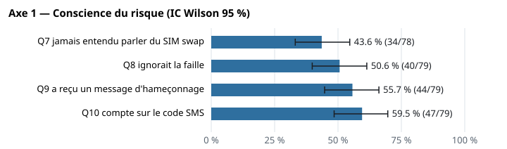
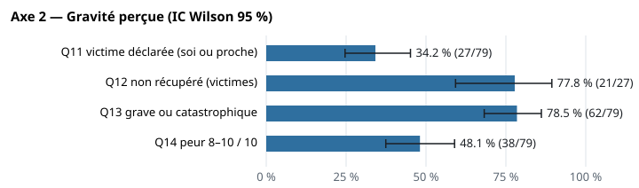
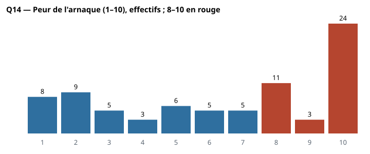
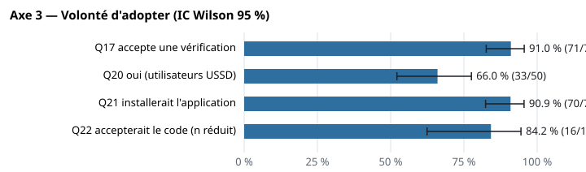
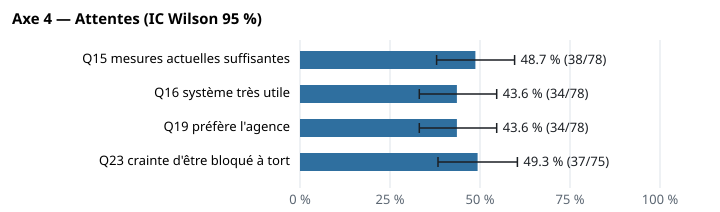

# Analyse du sondage utilisateurs — v1

- **Statut** : **FIGÉ** le 2026-10-08, après relecture du propriétaire
- **Date** : 2026-10-08
- **Corrections de relecture (2026-10-08)** :
  1. Limite n° 2 : Q20 retirée de la liste des intervalles supérieurs à ± 15 points (± 12,7) ; seules Q12 et Q22 y restent.
  2. Q11 : l'indicateur principal devient « moi-même » (13/79), comparable FR/EN. Le total 27/79 n'est plus un résultat, il ne sert que de population à Q12 (mélange non comparable).
  3. Lecture de l'axe 2 : « presque jamais » remplacé par « dans 78 % des cas déclarés (n = 27) ».
  4. Lecture de l'axe 4 : « les faux positifs sont le risque d'adoption principal » remplacé par « chez ces répondants, la crainte d'un blocage injustifié est le premier frein cité ».
  5. Q19 : le code de secours de la conception n'était pas une option ; c'est Q22 qui le teste.
  6. Limites : ajout du consentement oral et de l'absence de données nominatives.
  7. Publication du jeu dé-identifié `reponses_anonymisees.csv`, avec un test toujours exécuté qui en recalcule l'oracle ; le nombre de tests passe de 11 à 14.
- **Objet** : exigence du superviseur pour la soutenance de jalon. Il s'agit des blocs « collecte de données » et « analyse & résultats ».
- **Source** : deux exports Google Forms, un formulaire FR (45 soumissions) et un formulaire EN (36 soumissions). Ils ne sont **jamais versionnés** : `data/survey/raw/` est ignoré par git. Seuls le code, les agrégats, les figures et le jeu dé-identifié sont dans le dépôt.
- **Outil** : `tools/survey` (`python -m isc_survey.analysis`), déterministe, bibliothèque standard seule (ADR-033). Il est testé : 14 tests, dont deux qui rejouent l'oracle du superviseur : l'un sur les exports bruts (ignoré s'ils sont absents), l'autre sur le jeu dé-identifié publié (exécuté **toujours**).
- **Agrégats bruts** : `docs/03-donnees/sondage/agregats_sondage_v1.json`, plus 5 figures SVG dans le même dossier.
- **Jeu dé-identifié** : `docs/03-donnees/sondage/reponses_anonymisees.csv`, 79 lignes. Il contient les codes harmonisés et la colonne langue, **sans horodatage**, et ses lignes sont mélangées avec une graine fixe (`ANON_SEED`), donc l'ordre ne porte aucune information. Les soumissions vides en sont exclues. Les 11 valeurs de l'oracle se recalculent **à partir de ce seul fichier** (c'est testé).

> Toutes les proportions portent un **intervalle de confiance de Wilson à 95 %**, la méthode adaptée aux petits effectifs et déjà utilisée dans le rapport de plausibilité. Le dénominateur **n** est le nombre de répondants qui ont répondu à la question, dans la population indiquée. Il varie d'une question à l'autre, parce que les questions sans réponse ne sont pas comptées.

---

## 0. Traitement des données

| Règle | Application |
|---|---|
| Soumissions vides | **1 par fichier**, entièrement vide, est exclue. Il reste **79 répondants valides** (FR 44, EN 35) |
| Harmonisation FR/EN | Une table explicite (`tools/survey/src/isc_survey/labels.py`) associe chaque libellé à un code commun. **Un libellé non reconnu fait échouer le script**, il n'est jamais ignoré (c'est testé) |
| Q6 (solde) | **Non fusionnée.** Le formulaire FR demande le solde maximum « déjà eu », le formulaire EN le solde maximum « par mois ». Ce sont deux questions différentes, rapportées séparément |
| Q11 (victime) | Indicateur principal : **« moi-même »**, seule option présente dans les deux formulaires, donc comparable FR/EN |
| Q12 (argent récupéré) | Restreinte aux **victimes déclarées** en Q11 : soi-même, ou un proche (option qui n'existe qu'en EN). Ce total (27) est un mélange non comparable et ne sert que de population à Q12 |
| Q20 (protection USSD) | Restreinte aux **utilisateurs USSD** en Q3 : USSD, ou les deux canaux |
| Q22 (code de secours) | **Ajoutée le 2026-09-24**, en cours de collecte : seuls **19** répondants l'ont vue et y ont répondu |
| Q14 (peur, 1 à 10) | Médiane, distribution, parts 8–10 et 1–3, en plus de la moyenne |

### Contrôle contre l'oracle du superviseur

Un calcul indépendant du superviseur a fixé 11 valeurs à retrouver exactement. **Les 11 sont retrouvées à l'unité près.**

| Indicateur | Oracle | Résultat |
|---|--:|--:|
| N valides (FR, EN) | 79 (44, 35) | **79 (44, 35)** |
| Q8 ignorait la faille | 40/79 | **40/79** |
| Q10 compte sur le code SMS | 47/79 | **47/79** |
| Q12 non récupéré (victimes) | 21/27 | **21/27** |
| Q13 grave + catastrophique | 62/79 | **62/79** |
| Q14 médiane | 7 | **7** |
| Q17 accepte une vérification | 71/78 | **71/78** |
| Q20 « oui » (utilisateurs USSD) | 33/50 | **33/50** |
| Q21 installerait | 70/77 | **70/77** |
| Q22 accepterait le code | 16/19 | **16/19** |
| Q23 crainte d'être bloqué à tort | 37/75 | **37/75** |

---

## 1. Profil des répondants (Q1–Q5)

| Question | Résultat (total) [IC 95 %] |
|---|---|
| Q1 Activité | **étudiants 46/79 = 58,2 %** [47,2–68,5] ; salariés 12 (15,2 %) ; sans emploi 12 (15,2 %) ; indépendants 9 (11,4 %) |
| Q2 Service utilisé | les deux 39/77 = 50,6 % [39,7–61,5] ; Orange Money seul 24 (31,2 %) ; MTN MoMo seul 14 (18,2 %) |
| Q3 Canal principal | application 29/79 = 36,7 % [26,9–47,7] ; les deux 27 (34,2 %) ; **USSD 23 (29,1 %)** [20,3–39,9]. Utilisateurs USSD (USSD ou les deux) : **50/79** |
| Q4 Fréquence | plusieurs fois par semaine 35/78 = 44,9 % ; tous les jours 33 (42,3 %) ; quelques fois par mois 9 (11,5 %) ; rarement 1 (1,3 %) |
| Q5 Usages (plusieurs réponses) | envoyer / recevoir **70/79 = 88,6 %** [79,8–93,9] ; factures 38 (48,1 %) ; achats chez des marchands 33 (41,8 %) ; salaire 15 (19,0 %) ; épargne 11 (13,9 %) |

**Q6, solde maximum, non fusionnée :**

| Tranche | FR, « déjà eu » (n = 43) | EN, « par mois » (n = 35) |
|---|--:|--:|
| < 10 000 | 5 (11,6 %) | 3 (8,6 %) |
| 10 000 – 50 000 | 7 (16,3 %) | 6 (17,1 %) |
| 50 000 – 100 000 | 4 (9,3 %) | 8 (22,9 %) |
| 100 000 – 250 000 | 9 (20,9 %) | 7 (20,0 %) |
| 250 000 – 500 000 | 9 (20,9 %) | 4 (11,4 %) |
| > 500 000 | 9 (20,9 %) | 7 (20,0 %) |

---

## 2. Axe 1 — Conscience du risque (Q7–Q10)



| Indicateur | Total [IC 95 %] | FR | EN |
|---|--:|--:|--:|
| Q7 n'a **jamais entendu parler** du SIM swap | **34/78 = 43,6 %** [33,1–54,6] | 22/43 (51,2 %) | 12/35 (34,3 %) |
| Q7 le connaît bien | 24/78 = 30,8 % [21,6–41,7] | — | — |
| Q8 **ignorait** que les fonds peuvent être volés par une nouvelle SIM | **40/79 = 50,6 %** [39,8–61,4] | 22/44 (50,0 %) | 18/35 (51,4 %) |
| Q9 a reçu un message d'hameçonnage (une fois ou souvent) | 44/79 = 55,7 % [44,7–66,1] | 23/44 (52,3 %) | 21/35 (60,0 %) |
| Q10 **compte sur le code SMS** comme protection principale | **47/79 = 59,5 %** [48,5–69,6] | 26/44 (59,1 %) | 21/35 (60,0 %) |

**Lecture.** Un répondant sur deux ignorait la faille exploitée par le SIM swap (Q8). Six sur dix comptent sur le code SMS (Q10), c'est-à-dire précisément sur le facteur que le SIM swap détourne : l'OTP arrive sur la SIM de l'attaquant (AC-02). La conscience du risque est donc faible là où la thèse place le danger.

---

## 3. Axe 2 — Gravité perçue (Q11–Q14)



| Indicateur | Total [IC 95 %] | FR | EN |
|---|--:|--:|--:|
| Q11 **victime elle-même** (« moi-même », seule option présente dans les deux formulaires) | **13/79 = 16,5 %** [9,9–26,2] | 8/44 (18,2 %) [9,5–32,0] | 5/35 (14,3 %) [6,3–29,4] |
| Q11 en a entendu parler par d'autres | 43/79 = 54,4 % [43,5–65,0] | — | — |
| Q12 **argent non récupéré**, chez les victimes déclarées (population : voir la note) | **21/27 = 77,8 %** [59,2–89,4] | 5/8 (62,5 %) | 16/19 (84,2 %) |
| Q12 récupéré en totalité, chez les victimes | 3/27 = 11,1 % [3,9–28,1] | — | — |
| Q13 vol du solde **grave ou catastrophique** | **62/79 = 78,5 %** [68,2–86,1] | 37/44 (84,1 %) | 25/35 (71,4 %) |
| Q13 dont catastrophique (entreprise, loyer, scolarité) | 15/79 = 19,0 % [11,9–29,0] | — | — |

**Population de Q12.** Q12 est posée aux 27 victimes déclarées en Q11 : « moi-même » (FR + EN, 13) et « un proche » (EN seul, 14). C'est un **mélange soi-même (FR+EN) et proche (EN seul), non comparable** entre FR et EN. Ce total n'est donc pas un résultat sur la victimisation ; il sert seulement de dénominateur à Q12. L'indicateur de victimisation est « moi-même » (16,5 %).

**Q14 — Peur de se faire arnaquer, échelle de 1 à 10** (n = 79) :



| Statistique | Total | FR (n = 44) | EN (n = 35) |
|---|--:|--:|--:|
| **Médiane** | **7** | 8 | 6 |
| Moyenne | 6,37 | 6,66 | 6,00 |
| Part 8–10 (peur forte) | **38/79 = 48,1 %** [37,4–59,0] | 23/44 (52,3 %) | 15/35 (42,9 %) |
| Part 1–3 (peur faible) | 22/79 = 27,8 % [19,2–38,6] | 12/44 (27,3 %) | 10/35 (28,6 %) |

Distribution (effectifs, de 1 à 10) : 8 · 9 · 5 · 3 · 6 · 5 · 5 · 11 · 3 · **24**.

**Lecture.** La distribution est **bimodale**. Près d'un répondant sur deux est à 8–10, et 24 sont à 10. Mais un quart est à 1–3. La moyenne (6,4) masque ces deux groupes ; la médiane (7) et les parts aux extrêmes les montrent. Quand une victime perd son argent, elle ne le récupère pas dans 78 % des cas déclarés (n = 27), et le vol serait grave pour près de 8 répondants sur 10.

---

## 4. Axe 3 — Volonté d'adopter (Q17, Q18, Q20, Q21, Q22)



| Indicateur | Total [IC 95 %] | FR | EN |
|---|--:|--:|--:|
| Q17 **accepte une vérification supplémentaire** en cas de transaction inhabituelle | **71/78 = 91,0 %** [82,6–95,6] | 37/43 (86,0 %) | 34/35 (97,1 %) |
| … dont « à chaque fois si nécessaire » | 45/78 = 57,7 % [46,6–68,0] | — | — |
| … dont « à condition que cela reste rare » | 26/78 = 33,3 % [23,9–44,4] | — | — |
| Q18 accepte des limites après un changement de SIM | 42/77 = 54,5 % [43,5–65,2] ; « ça dépend » 26 (33,8 %) ; non 9 (11,7 %) | — | — |
| Q20 **souhaite la protection USSD**, chez les utilisateurs USSD | **33/50 = 66,0 %** [52,2–77,6] ; sans avis 14 (28,0 %) ; non 3 (6,0 %) | 14/25 (56,0 %) | 19/25 (76,0 %) |
| Q21 **installerait l'application** liée au téléphone | **70/77 = 90,9 %** [82,4–95,5] | 37/42 (88,1 %) | 33/35 (94,3 %) |
| … dont « seulement si c'est gratuit » | 38/77 = 49,4 % [38,5–60,3] | — | — |
| Q22 **accepterait un code de secours** à noter sur papier (*ajoutée le 24/09, n = 19*) | **16/19 = 84,2 %** [62,4–94,5] | 9/11 | 7/8 |
| … dont « mais j'aurais peur de le perdre » | 8/19 = 42,1 % [23,1–63,7] | — | — |

**Lecture.** L'acceptation **déclarée** est élevée. Neuf répondants sur dix accepteraient une vérification supplémentaire et installeraient l'application, et deux utilisateurs USSD sur trois veulent la protection sur leur canal. Deux nuances : la moitié n'installerait l'application **que si elle est gratuite**, et un tiers ne tolère la vérification que si elle **reste rare**. Ce deuxième point rejoint la contrainte de faux positifs de la calibration T3-07. Sur Q22, l'intervalle est très large ([62–94 %]) faute d'effectif, et 8 répondants sur 19 craignent de perdre le code.

---

## 5. Axe 4 — Attentes envers la solution (Q15, Q16, Q19, Q23)



| Indicateur | Total [IC 95 %] |
|---|--:|
| Q15 les mesures actuelles (PIN + code SMS) **suffisent** | 38/78 = 48,7 % [38,0–59,6] (FR 41,9 % ; EN 57,1 %) |
| Q16 système jugé **très utile** | 34/78 = 43,6 % [33,1–54,6] ; modérément utile 32 (41,0 %) ; inutile 12 (15,4 %) |
| Q19 méthode de récupération préférée (le code de secours de la conception n'était **pas** proposé ; voir Q22) | **agence avec pièce d'identité 34/78 = 43,6 %** [33,1–54,6] ; e-mail de récupération 30 (38,5 %) ; personne de confiance 14 (17,9 %) [11,0–27,9] |
| Q23 freins à l'adoption (plusieurs réponses, n = 75) | **crainte d'être bloqué à tort 37/75 = 49,3 %** [38,3–60,4] ; trop compliqué 22 (29,3 %) ; confidentialité 18 (24,0 %) ; rien, adopterait sans hésiter 17 (22,7 %) ; coût 1 (1,3 %, option EN seulement) |

**Lecture.** Le **premier frein** cité est la **crainte d'être bloqué à tort** : un répondant sur deux. C'est exactement le coût mesuré en T3-07, où les annulations de STEP_UP sur USSD touchent une part importante des usagers légitimes. Chez ces répondants, **la crainte d'un blocage injustifié est le premier frein cité**, avant la complexité. Les répondants sont partagés sur la suffisance des mesures actuelles (environ 1 sur 2). Pour la récupération, ils préfèrent l'agence physique ; le contact de confiance, prévu par la conception, ne recueille que 18 %. **Le code de secours retenu par la conception (ADR-029) ne figurait pas parmi les options de Q19** : Q19 ne peut donc ni le confirmer ni l'écarter. C'est **Q22** qui le teste (16/19 l'accepteraient, sur un effectif réduit).

---

## 6. Limites

1. **Échantillon non probabiliste.** Les répondants se sont auto-sélectionnés via Google Forms, dans le réseau du propriétaire, et sont **à 58 % des étudiants** (46/79). Les résultats décrivent **cet échantillon** et **ne se généralisent pas** à la population des utilisateurs Mobile Money au Cameroun. Les intervalles de Wilson mesurent l'incertitude d'échantillonnage, pas ce biais de sélection.
2. **Effectif insuffisant** : n = 79 valides, sous la cible de 100. Les intervalles sont larges, souvent ± 10 points. Ils dépassent ± 15 points sur Q12 (n = 27, victimes déclarées) et sur Q22 (n = 19). Q20 (n = 50, utilisateurs USSD) reste sous ce seuil (± 12,7 points).
3. **Intention déclarée ≠ comportement.** Q17, Q18, Q20, Q21 et Q22 mesurent ce que les répondants **disent** qu'ils feraient, pas ce qu'ils feraient. L'acceptation réelle d'une vérification, d'un blocage ou d'une installation payante est probablement plus basse.
4. **Asymétries entre les formulaires FR et EN** :
   - **Q6** : « déjà eu » en FR contre « par mois » en EN. La question n'est pas la même, donc pas de fusion.
   - **Q11** : l'option « un proche » n'existe qu'en EN. Seul « moi-même » est comparable (FR 18,2 %, EN 14,3 %). La population de Q12 mélange soi-même et proche, et elle est déséquilibrée (8 FR, 19 EN).
   - **Q22** : les options de refus diffèrent (« autre méthode » en FR, « trop contraignant » en EN).
   - **Q23** : l'option « coût » n'existe qu'en EN (1 réponse).
5. **Q22 ajoutée en cours de collecte**, le 2026-09-24. Les répondants antérieurs ne l'ont pas vue : n = 19, sans garantie que ces 19 ressemblent aux 60 autres.
6. **Libellés imparfaits dans les formulaires.** Certaines options du formulaire FR sont en anglais (Q8, Q9 : « Yes / No » ; Q3 : « Both »), et certains libellés contiennent des coquilles (« 250,000f », « immediatly »). L'harmonisation les rattache explicitement aux codes communs ; elle ne corrige pas le sens des questions.
7. **Consentement recueilli oralement ; aucune donnée nominative collectée.** Le formulaire ne demande ni nom, ni numéro, ni adresse. La seule donnée de contexte individuelle, l'horodatage de soumission, n'est jamais versionnée ni publiée.

---

## 7. Reproduire

Depuis `tools/survey/`, une fois les deux exports placés dans `data/survey/raw/` (non versionné) :

```text
uv run python -m isc_survey.analysis --fr ../../data/survey/raw/reponses_fr.csv --en ../../data/survey/raw/reponses_en.csv --out-dir ../../docs/03-donnees/sondage
uv run pytest -q   # 14 tests ; l'oracle est rejoué sur le jeu dé-identifié (toujours) et sur les exports bruts (s'ils sont présents)
```

La sortie est identique à l'octet d'une exécution à l'autre (c'est testé). Elle ne contient aucun horodatage de soumission. Les réponses individuelles n'y figurent que dans `reponses_anonymisees.csv`, sous forme de codes harmonisés, dé-identifiées et mélangées.

Sans les exports bruts, l'analyse se vérifie depuis le jeu publié : `load_anonymised("docs/03-donnees/sondage/reponses_anonymisees.csv")`, puis `analyse()`.

## 8. Traçabilité

- **Amont** : exigence du superviseur (soutenance de jalon) ; ADR-033 (bibliothèque standard).
- **Liens avec la conception** : Q10 et Q8 → AC-02 (OTP détourné par le SIM swap) ; Q23 « bloqué à tort » et Q17 « si c'est rare » → contrainte de faux positifs de la calibration T3-07 et d'ADR-016 ; Q19 → récupération (ADR-029, contact de confiance) ; Q20 → protection résiduelle USSD.
